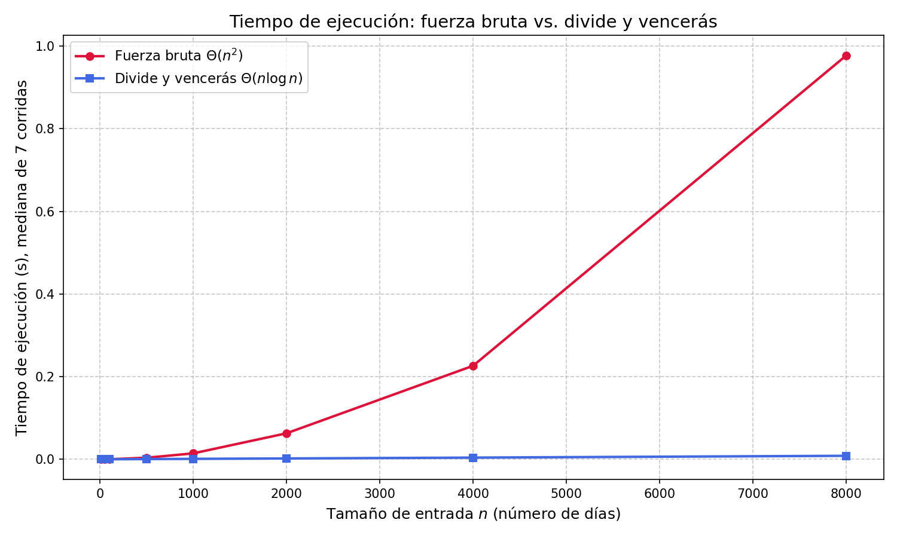

# Laboratorio 2 — Dividir y vencer: subarreglo máximo

**Estudiante:** Jose Fernando Sepulveda

**Código:** [`subarreglo.py`](subarreglo.py) (algoritmos) · [`pruebas.py`](pruebas.py) (pruebas) · [`medicion.py`](medicion.py) (experimento y gráfica)

## Cómo reproducir

Desde la carpeta `laboratorios/lab2-divide-y-vencer/`:

```bash
# 1. Activar el entorno virtual (el que tenga matplotlib instalado)
source .venv/bin/activate          # Windows: .venv\Scripts\activate
pip install matplotlib             # solo si aún no está instalado

# 2. Ejecutar las pruebas (debe terminar con "Todas las pruebas pasaron exitosamente.")
python pruebas.py

# 3. Ejecutar la medición (imprime la tabla y regenera graficas/tiempo_vs_n.png)
python medicion.py
```

---

## Parte 1. Recurrencia y complejidades teóricas

El algoritmo ([`subarreglo_maximo`](subarreglo.py)) divide la serie de $n$ días en **2 mitades** de tamaño $n/2$ y resuelve cada una de forma recursiva. Luego busca el mejor tramo que **cruza el punto medio** con dos barridos lineales (uno hacia la izquierda y otro hacia la derecha desde el medio), lo que cuesta $\Theta(n)$. La respuesta es el mayor de los tres candidatos (izquierda, derecha, cruzado).

$$T(n) = 2T\left(\frac{n}{2}\right) + \Theta(n)$$

- $2T(n/2)$: las dos llamadas recursivas sobre mitades.
- $\Theta(n)$: el tramo cruzado. Los dos barridos visitan cada posición del rango exactamente una vez, así que en total recorren los $n$ elementos de ese rango: un recorrido lineal.

**Método maestro.** Con $a = 2$, $b = 2$ y $f(n) = \Theta(n)$: $n^{\log_b a} = n^{\log_2 2} = n$. Como $f(n) = \Theta(n^{\log_b a})$, aplica el **caso 2** y

$$T(n) = \Theta(n \log n).$$

**Resolución paso a paso (árbol de recursión).** Si el costo del cruce es $c\,n$:

| Nivel | Subproblemas | Tamaño de cada uno | Costo del nivel |
|---|---|---|---|
| 0 | 1 | $n$ | $c\,n$ |
| 1 | 2 | $n/2$ | $2 \cdot c\,n/2 = c\,n$ |
| 2 | 4 | $n/4$ | $4 \cdot c\,n/4 = c\,n$ |
| $k$ | $2^k$ | $n/2^k$ | $c\,n$ |

Cada nivel cuesta lo mismo, $c\,n$, porque los cruces de ese nivel se reparten el arreglo completo sin solaparse. El árbol se detiene cuando el tamaño es 1, es decir, en $k = \log_2 n$, así que hay $\log_2 n + 1$ niveles. El total es $c\,n(\log_2 n + 1) + \Theta(n)$ de las hojas $= \Theta(n \log n)$.

**Fuerza bruta** ([`subarreglo_fuerza_bruta`](subarreglo.py)). Prueba todos los pares $(i, j)$ con $0 \le i \le j < n$, acumulando la suma dentro del ciclo interno. El número de iteraciones es

$$\sum_{i=0}^{n-1} (n - i) = \frac{n(n+1)}{2},$$

y cada una hace una suma y una comparación en tiempo constante. Por eso la fuerza bruta es $\Theta(n^2)$.

---

## Parte 2. Lo medido contra lo esperado

**Cómo se midió.** Semilla fija (`42`), datos enteros aleatorios en $[-100, 100]$ generados fuera del cronómetro, y **la mediana de 7 repeticiones** por tamaño y por algoritmo (con la mediana un pico aislado por ruido del sistema no mueve el resultado). Los tamaños son 10, 50, 100, 500, 1000, 2000, 4000 y 8000. En cada tamaño el programa verifica que ambos algoritmos den la misma suma.



Valores medidos (salida de `python medicion.py`, una máquina y una ejecución concretas; los tiempos absolutos cambian de equipo en equipo, las proporciones deberían parecerse):

| $n$ | Fuerza bruta (s) | Divide y vencerás (s) | FB / DV |
|---:|---:|---:|---:|
| 10 | 0.000002 | 0.000006 | 0.3 |
| 50 | 0.000030 | 0.000033 | 0.9 |
| 100 | 0.000108 | 0.000069 | 1.6 |
| 500 | 0.003738 | 0.000450 | 8.3 |
| 1000 | 0.014265 | 0.001020 | 14.0 |
| 2000 | 0.062852 | 0.001976 | 31.8 |
| 4000 | 0.226269 | 0.004012 | 56.4 |
| 8000 | 0.977555 | 0.008402 | 116.3 |

**Factor al duplicar $n$** (de 4000 a 8000):

- **Fuerza bruta:** $0.226269 \to 0.977555$ s, factor $\approx 4.32$. La predicción de $\Theta(n^2)$ es $(2n)^2/n^2 = 4$. Los factores de las otras duplicaciones son $4.41$ (1000→2000) y $3.60$ (2000→4000): oscilan alrededor de 4, y esa variación es ruido de la máquina (memoria caché, planificador del sistema), no un cambio de comportamiento.
- **Divide y vencerás:** $0.004012 \to 0.008402$ s, factor $\approx 2.09$. La predicción de $\Theta(n \log n)$ es

$$\frac{2n \log_2(2n)}{n \log_2 n} = 2\left(1 + \frac{1}{\log_2 n}\right) \approx 2.17 \quad (n = 4000).$$

  El valor medido (2.09) es un poco menor que el teórico por el ruido de la medición, pero claramente cercano a 2 y lejos de 4. Un algoritmo $\Theta(n^2)$ cuadruplicaría el tiempo.

Ambos comportamientos coinciden con lo esperado. Además, la brecha crece con $n$: en $n = 8000$ la fuerza bruta tarda unas 116 veces más.

### Comportamiento en tamaños pequeños

- En $n = 10$ la fuerza bruta es más rápida (2 µs contra 6 µs): hace pocas iteraciones y no paga el costo de las llamadas recursivas ni del cálculo de puntos medios.
- En $n = 50$ están empatados en la práctica (30 µs contra 33 µs; la diferencia es del orden del ruido).
- En $n = 100$ divide y vencerás ya gana (69 µs contra 108 µs). Con $n = 100$, la fuerza bruta hace $100 \cdot 101 / 2 = 5050$ iteraciones, mientras que $n \log_2 n \approx 664$.

Por lo tanto, en esta máquina el **punto de cruce está entre $n = 50$ y $n = 100$**. Para $n$ tan pequeño, los tiempos son de **microsegundos**, no de milisegundos; la diferencia entre los dos algoritmos no importa en la práctica y solo se vuelve relevante a partir de unos cientos de días.

---

## Parte 3. Cuándo conviene dividir y recomendación

### ¿Cuándo conviene dividir?

No siempre conviene. Para hallar el **máximo de un arreglo** de $n$ números:

- **Recorrido simple:** una pasada comparando elementos, $\Theta(n)$.
- **Divide y vencerás:** buscar el máximo de cada mitad y comparar los dos resultados, con costo $\Theta(1)$ de combinación: $T(n) = 2T(n/2) + \Theta(1)$. Como $n^{\log_2 2} = n$ y $f(n) = \Theta(1) = O(n^{1-\varepsilon})$, aplica el **caso 1** y $T(n) = \Theta(n)$.

Dividir no mejora la complejidad: ambos son $\Theta(n)$ (y la versión recursiva agrega el costo de las llamadas). Dividir conviene cuando la combinación es **barata** respecto del problema original y evita examinar todas las combinaciones posibles, como en el subarreglo máximo, donde se pasa de $\Theta(n^2)$ a $\Theta(n \log n)$ porque el cruce se resuelve con un solo recorrido lineal en lugar de probar todos los pares.

### Recomendación para la gerencia

Recomiendo adoptar **divide y vencerás**: según las mediciones de la Parte 2, desde unos cientos de días ya es varias veces más rápido, y la ventaja crece con el tamaño de la serie.

**Estimación para 1.000.000 de registros.** Es una *extrapolación* a partir de las mediciones y se calcula suponiendo que $t(n) = c \cdot f(n)$ con $c$ constante.

- **Fuerza bruta**, $t(n) \approx c_1 n^2$. Con $n = 8000$ y $t = 0.977555$ s: $c_1 \approx 1.53 \times 10^{-8}$ s. Para $n = 10^6$: $t \approx 1.53 \times 10^{-8} \cdot 10^{12} \approx 15{,}300$ s $\approx$ **4.2 horas**. (Con la medición de $n = 4000$ se obtiene $\approx 3.9$ h.)
- **Divide y vencerás**, $t(n) \approx c_2\, n \log_2 n$. Con $n = 8000$ y $t = 0.008402$ s: $c_2 \approx 8.10 \times 10^{-8}$ s. Para $n = 10^6$ ($\log_2 10^6 \approx 19.93$): $t \approx 8.10 \times 10^{-8} \cdot 10^6 \cdot 19.93 \approx$ **1.6 segundos**. (Con $n = 4000$ se obtiene $\approx 1.7$ s.)

**Qué puede alterar el resultado.** Es una estimación, no una medición: se extrapola 125 veces más allá del mayor tamaño medido. Con $10^6$ datos la lista deja de caber en la memoria caché del procesador, lo que normalmente hace los tiempos *mayores* que la proyección; el equipo de la cooperativa puede ser más lento o más rápido que el de las pruebas; y las constantes $c_1, c_2$ varían entre ejecuciones (de ahí los rangos 3.9–4.2 h y 1.6–1.7 s). Lo que sí es robusto es el orden de magnitud: **horas** con fuerza bruta frente a **segundos** con divide y vencerás, por cada serie de ese tamaño.
