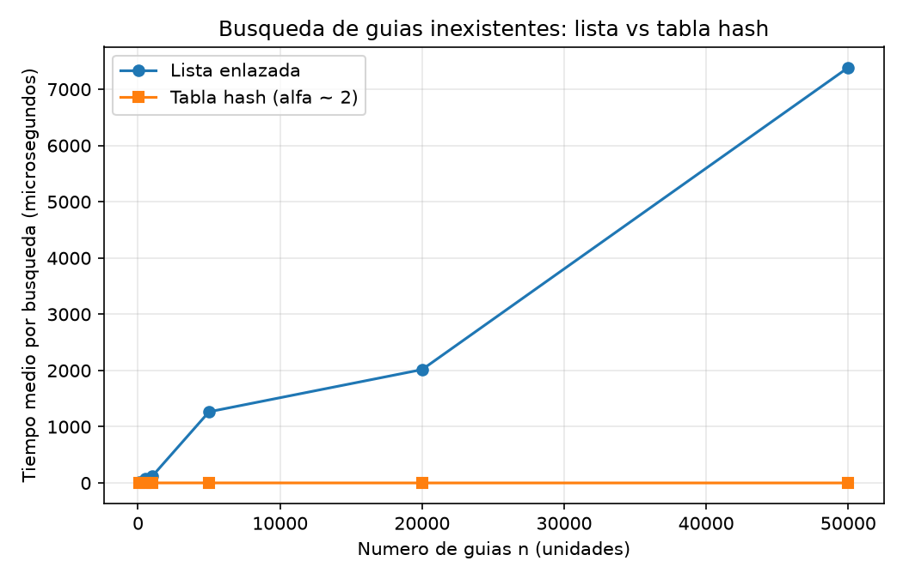
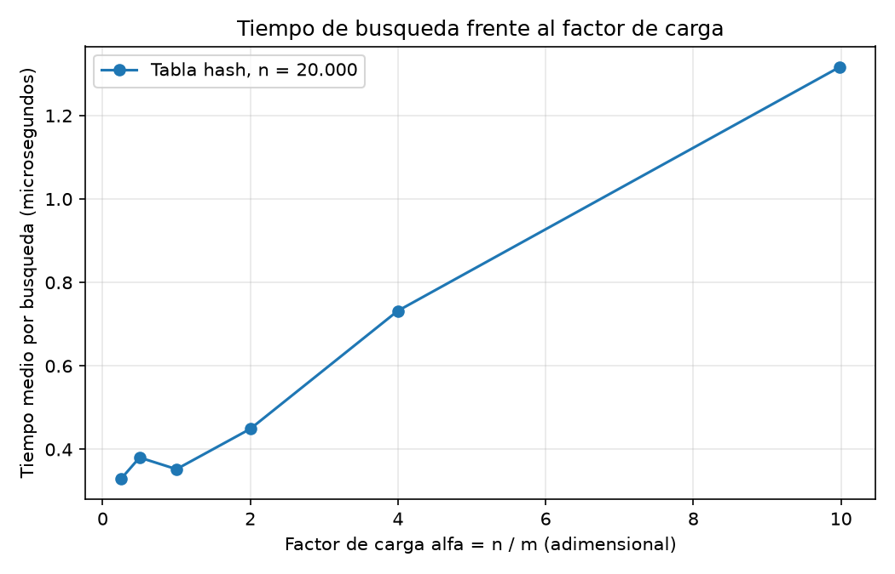

# Laboratorio evaluativo 03 — Estructuras de datos

**Nombre completo:** JOSE FERNANDO SEPULVEDA CHANCI

## Cómo reproducir

```bash
source .venv/bin/activate        # entorno virtual de la raíz del repositorio
cd lab3-estructuras-datos
python pruebas.py                # pruebas con assert
python medicion.py               # experimentos A y B y gráficas
```

## Parte 1 — Implementación y verificación

Código: [estructuras.py](estructuras.py) · [pruebas.py](pruebas.py)

Las estructuras se verificaron con `pruebas.py` (script con `assert`). Casos cubiertos:

- Búsqueda exitosa e infructuosa en la lista y en la tabla, incluida la lista vacía y una casilla vacía.
- Colisión forzada con `m = 7`: las guías 10, 24 y 17 caen en la casilla 3, se insertan y se encuentran después, y la lista de esa casilla tiene longitud 3.
- `factor_carga()` devuelve `3 / 7` tras esas tres inserciones.
- 25 colecciones aleatorias (semillas 0 a 24, distintos `n` y `m`) en las que lista y tabla devuelven lo mismo para guías existentes e inexistentes.

## Parte 2 — Medición

Código: [medicion.py](medicion.py)





**Cómo se midió.** Semilla fija 42 para las guías; 200 búsquedas de guías inexistentes por valor de `n`; se reporta el mejor de 3 repeticiones; el cronómetro (`time.perf_counter()`) rodea solo las búsquedas. En el Experimento A, `n` = 100, 500, 1000, 5000, 20000 y 50000, con `m` primo cercano a `n/2` (53, 251, 503, 2503, 10007, 25013), de modo que α ≈ 2. En el Experimento B, `n` = 20.000 y `m` = 80021, 40009, 20011, 10007, 5003 y 2003 (α ≈ 0,25; 0,5; 1; 2; 4 y 10). Antes de medir, el programa verifica que lista y tabla devuelven el mismo estado para una muestra de guías existentes.

| n | m | α | Lista (µs) | Tabla (µs) |
|---|---|---|---|---|
| 100 | 53 | 1,89 | 3,661 | 0,249 |
| 500 | 251 | 1,99 | 13,699 | 0,166 |
| 1000 | 503 | 1,99 | 26,540 | 0,169 |
| 5000 | 2503 | 2,00 | 121,364 | 0,269 |
| 20000 | 10007 | 2,00 | 622,844 | 0,170 |
| 50000 | 25013 | 2,00 | 1492,427 | 0,178 |

## Parte 3 — Análisis

### 1. Costo teórico
En la lista enlazada, buscar una guía inexistente recorre obligatoriamente los n nodos hasta el final porque no existe indexación. En la tabla hash con encadenamiento, el costo promedio $\Theta(1 + \alpha)$ se compone de dos partes: el $1$ del cálculo aritmético del hash para ubicar la casilla, y el factor de carga $\alpha$ ($n / m$), que representa el largo promedio de la lista en esa casilla. Esto se cumple bajo el supuesto de hashing uniforme simple, donde las claves se distribuyen de forma independiente. Si ese supuesto falla y todas caen en una sola casilla, la tabla se degrada a una lista enlazada y el costo sube a $\Theta(n)$.

### 2. Lo medido contra lo esperado
En la primera gráfica (`lista_vs_tabla.png`), al multiplicar $n$ por $4$ (de $5.000$ a $20.000$), el tiempo de la lista pasó de $121,4$ a $622,8$ microsegundos ($\times 5,1$). Esto supera el $\times 4$ esperado, lo cual podría atribuirse de forma tentativa a un mayor impacto de la memoria caché con estructuras más grandes. De $20.000$ a $50.000$ guías ($n$ multiplicado por $2,5$), el tiempo subió a $1.492,4$ microsegundos ($\times 2,4$), un valor muy cercano al $\times 2,5$ esperado por $\Theta(n)$. La tabla hash en esos mismos tramos pasó de $0,269$ a $0,170$ microsegundos de $5.000$ a $20.000$, y llegó a $0,178$ microsegundos en $50.000$. Cabe notar que el ruido de medición en la tabla es considerable: con la misma configuración ($n = 20.000, \alpha = 2$), dio $0,170$ µs en el Experimento A y $0,298$ µs en el B. 

En la segunda gráfica (`tiempo_vs_alfa.png`), al subir $\alpha$ de $0,5$ a $10$ ($\times 20$), el tiempo pasó de $0,116$ a $0,634$ microsegundos ($\times 5,5$). La teoría $\Theta(1 + \alpha)$ predice un aumento proporcional a $(1 + 10) / (1 + 0,5) \approx \times 7,3$. Sin embargo, dada la fragilidad frente al ruido, basta decir que ambos valores son del mismo orden. Al ajustar una recta con los puntos $(0,5; 0,116)$ y $(10; 0,634)$, el costo fijo inicial sale aproximadamente en $0,09$ microsegundos, lo que equivale al tiempo de recorrer unos $1,6$ nodos.

### 3. Explique las colisiones
Una colisión ocurre cuando dos guías distintas generan el mismo índice hash. Aunque la tabla tenga más casillas que guías ($m > n$), las colisiones ocurren por la paradoja del cumpleaños: con $n$ claves y $m$ casillas hay del orden de $n^2 / (2m)$ parejas que chocan, haciendo que las coincidencias aparezcan mucho antes de saturar el arreglo. 

El **encadenamiento** asigna una lista enlazada a cada casilla. Su ventaja es que soporta factores de carga altos ($\alpha > 1$), pero requiere memoria adicional para los punteros. El **direccionamiento abierto** guarda los elementos en el mismo arreglo y busca otra casilla libre mediante sondeo ante una colisión; su límite operativo exige que $\alpha \le 1$, y los borrados se complican porque requieren marcas de lápida (*tombstones*). 

*Ejemplo con $m = 7$:* Las guías $10$, $24$ y $17$ dan residuo $3$. Con **encadenamiento**, las tres se guardan en la lista de la casilla $3$. Con **direccionamiento abierto** (sondeo lineal), la guía $10$ ocupa la casilla $3$, la guía $24$ pasa a la casilla $4$ libre, y la guía $17$ se desplaza hasta la casilla $5$.

### 4. Tabla hash o árbol de búsqueda
Para consultas por rango ("guías entre X y Y"), la tabla hash no sirve porque dispersa las guías sin orden lógico, obligando a revisar toda la estructura ($\Theta(n + m)$). Un **Árbol de Búsqueda Binario (BST)** permite extraer rangos ordenados eficientemente en $\Theta(h + k)$ (donde $h$ es la altura y $k$ las guías devueltas). 

Si las $400.000$ guías llegaran ordenadas y se insertaran una a una en un BST sin balanceo, el árbol se degeneraría en una lista vertical con altura $h = n = 400.000$, lo que costaría unas $\Theta(n^2)$ operaciones acumuladas para la inserción total (del orden de $8 \times 10^{10}$ pasos), con un promedio de $200.000$ comparaciones por búsqueda. En contraste, un árbol equilibrado mantiene una altura estricta de $\log_2(400.000) \approx 18,6$ niveles, requiriendo un total aproximado de $n \log_2 n \approx 7,6 \times 10^6$ operaciones para insertarlas todas, y un máximo de unas $19$ a $22$ comparaciones por búsqueda individual.

### 5. Concepto para la jefa de operaciones
Se recomienda un **Árbol de Búsqueda Binario Auto-equilibrado (como un AVL)**. 

Con base en nuestras mediciones, para $n = 50.000$ la lista enlazada tardó $1.492$ microsegundos en búsquedas fallidas. Al estimar para $5.000.000$ de envíos (multiplicando $n$ por $100$), el tiempo de la lista subiría proporcionalmente hasta unos $150$ milisegundos ($\approx 0,15$ s), descartándola al no soportar rangos. Para la **tabla hash**, si el número de casillas $m$ crece junto con $n$ para mantener $\alpha \approx 2$, el tiempo de búsqueda se mantendría estable en el orden de $0,2$ microsegundos. Para el **AVL**, cada búsqueda puntual o por rango requeriría recorrer una altura de aproximadamente $22$ pasos (hasta $32$ en casos particulares). Aunque una tabla hash pura sigue siendo más rápida en búsqueda puntual estricta ($\Theta(1)$ frente a $\Theta(\log n)$), un AVL resuelve tanto la consulta puntual como el monitoreo por rango en una sola estructura, evitando duplicar memoria o sincronizar índices.